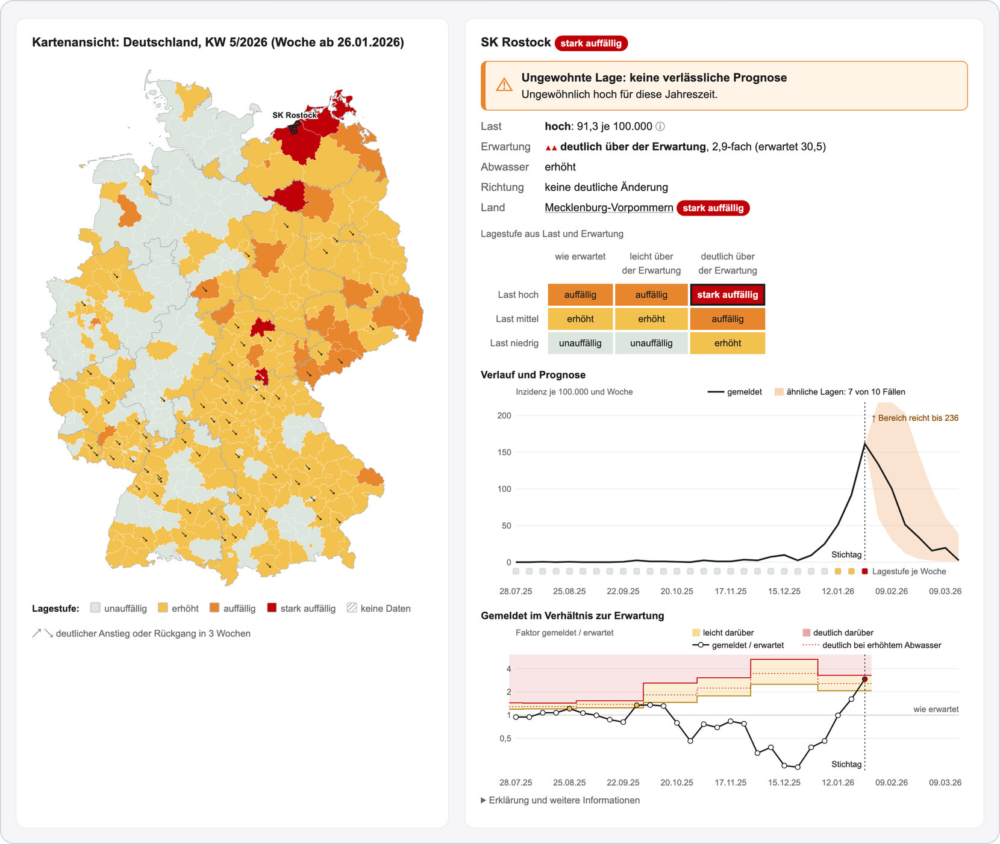
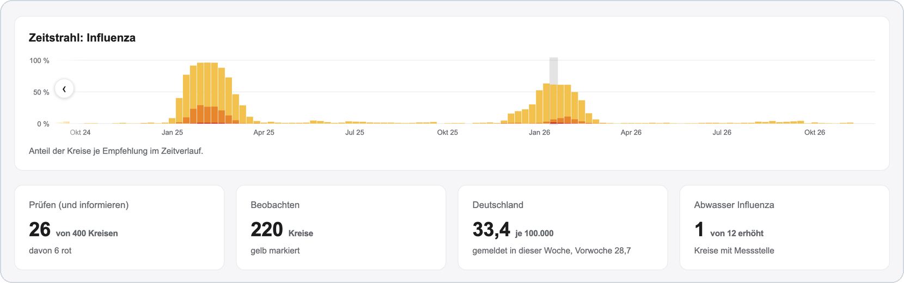
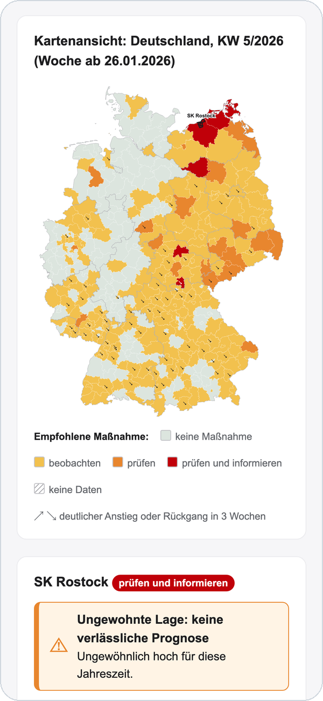

# Gemeinsames Lagebild Influenza

**Wo in Deutschland ist Influenza gerade ungewöhnlich, und was folgt daraus?** 
Jede Woche für alle 400 Kreise und 16 Länder: Last, Erwartung und empfohlene Maßnahme, dazu Abwasser und Prognose.

### [Lagebild öffnen →](https://2708tom.github.io/Lagebild-Influenza/)

<a href="https://2708tom.github.io/Lagebild-Influenza/">
<picture>
  <source media="(prefers-color-scheme: dark)" srcset=".github/bilder/vorschau-dunkel.png">
  
</picture>
</a>

Beispiel: Woche ab 26.01.2026. SK Rostock liegt deutlich über der Erwartung bei hoher Last; der orange Hinweis zeigt eine Lage, die das Modell aus früheren Saisons nicht kennt.

 

Die Seite läuft im Browser, ohne Anmeldung und ohne Installation. Sie wird jeden Montag und Donnerstag automatisch mit den neuesten Meldedaten und Abwasserwerten des Robert Koch-Instituts aktualisiert. Montags kommt die abgeschlossene Vorwoche dazu, donnerstags sind deren Nachmeldungen und das neue Abwasser vom Mittwoch eingerechnet.

## So lesen Sie das Lagebild

Jede Farbe ist eine Empfehlung. Sie ergibt sich aus zwei Fragen:

1. **Wie viel ist da? (Last)** Gemeldete Fälle je 100.000 Einwohner und Woche, gemittelt über die letzten drei Wochen. Die Grenzen für niedrig, mittel und hoch folgen dem europäischen Standard der Grippe-Überwachung (Moving Epidemic Method).
2. **Ist das ungewöhnlich? (Erwartung)** Ein Modell schätzt, wie viele Fälle in diesem Kreis zu dieser Jahreszeit normal wären. Verglichen wird gemeldet / erwartet. „Deutlich darüber“ heißt ungewöhnlich, nicht Ausbruch.

| Last | wie erwartet | leicht darüber | deutlich darüber |
|:--|:-:|:-:|:-:|
| **hoch** |  |  |  |
| **mittel** |  |  |  |
| **niedrig** |  |  |  |

**Abwasser.** Influenza im Abwasser ist eine zweite Quelle, die nicht davon abhängt, wie viel getestet wird. Ist es erhöht, gilt ein Kreis früher als deutlich darüber.

**Prognose.** Die Grafik zeigt den Verlauf und die Vorhersage für 1 bis 7 Wochen. In der grauen Fläche lag der gemeldete Wert im Test an früheren Saisons in 8 von 10 Fällen. Ein Pfeil (↗ ↘) zeigt einen deutlichen Anstieg oder Rückgang in drei Wochen an.

**Ungewohnte Lage.** Ein oranger Hinweis erscheint, wenn der Stand höher ist als fast je zuvor zu dieser Jahreszeit. Das Modell kennt solche Lagen nicht; statt einer Prognose zeigt die Seite, wie es in ähnlichen Lagen früherer Saisons weiterging.

**Zeitverlauf.** Der Zeitstrahl zeigt für jede Woche, welcher Anteil der Kreise beobachtet, geprüft oder informiert werden sollte. Ein Klick auf eine Woche zeigt deren Lage.

<picture>
  <source media="(prefers-color-scheme: dark)" srcset=".github/bilder/zeitstrahl-dunkel.png">
  
</picture>

## Unterwegs und offline

<table>
<tr>
<td width="260" valign="top">
<picture>
  <source media="(prefers-color-scheme: dark)" srcset=".github/bilder/handy-dunkel.png">
  
</picture>
</td>
<td valign="top">

**Auf jedem Gerät.** Die Seite passt sich an Handy, Tablet und Rechner an und folgt dem hellen oder dunklen Design des Geräts; ◐ oben rechts schaltet um.

**Bedienung.** Oben Gebiet (Deutschland oder ein Land) und Woche wählen, im Zeitstrahl zurückblättern, einen Kreis in Karte oder Tabelle anklicken.

**Exportieren.** „CSV ↓“ speichert die Kreistabelle, das Drucksymbol erzeugt eine Druckansicht, auch als PDF.

**Offline und weitergeben.** Das Lagebild ist eine einzige, vollständige Datei, die auch ohne Internet funktioniert: [Lagebild.html](Technik/08_Lagebild/Lagebild.html) öffnen, oben rechts auf das Download-Symbol klicken und die Datei per Doppelklick im Browser öffnen oder per E-Mail weitergeben.

</td>
</tr>
</table>

## Grenzen

- Proof of Concept einer Hochschularbeit, kein amtliches Produkt.
- Beobachten, prüfen und informieren sind Empfehlungen. Über Maßnahmen entscheidet die zuständige Behörde.
- Die jüngsten Wochen sind vorläufig, Nachmeldungen sind möglich.
- Ob eine Empfehlung im Einzelfall richtig lag, lässt sich mit offenen Daten nicht prüfen; Ausbruchsmeldungen der Gesundheitsämter sind nicht öffentlich.

## Daten und Technik

Robert Koch-Institut (SurvStat, AMELAG), Statistische Ämter des Bundes und der Länder, © GeoBasis-DE / BKG. Methode, Ablauf der wöchentlichen Aktualisierung, Installation und Quellen stehen im Ordner [Technik](Technik/).

## Lizenz

Eigene Inhalte dieses Repositorys (Code, Website, Texte und Bilder): © 2026 Tom Thum, veröffentlicht unter [Creative Commons Namensnennung 4.0 International (CC BY 4.0)](LICENSE). Weiterverwenden, verändern und weitergeben ist erlaubt, auch kommerziell, mit Nennung des Urhebers, einem Link zur Lizenz und dem Hinweis, ob etwas verändert wurde.

Die Daten gehören ihren Quellen und stehen unter deren eigenen Lizenzen (siehe [Technik](Technik/#datenquellen)).

 

Projektarbeit von Tom Thum in der Lehrveranstaltung „Epidemiologische Gefahren“ bei Prof. Dr. Dr. Alexander Lechleuthner Institut für Rettungsingenieurwesen und Gefahrenabwehr, Technische Hochschule Köln

